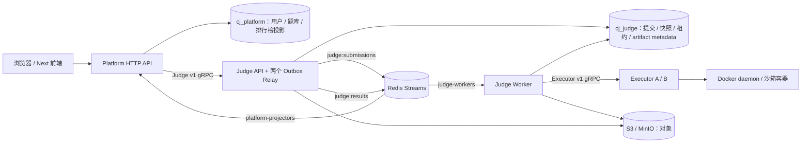
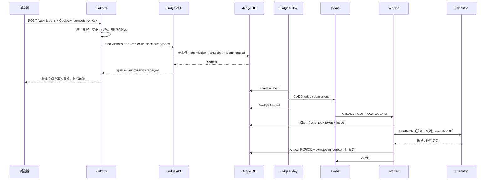

# 1. 架构、数据归属与各功能调用链

## 1.1 为什么拆：权限与生命周期不同

Platform 面向浏览器，处理登录、题库、限流和用户身份。Judge 处理提交、判题任务和权威结果。Executor 只负责执行不可信代码，持有 Docker Socket，不能把这份高权限交给 Web 服务。Worker 并发、Executor 资源、平台 HTTP 流量有不同扩容方式，因此拆分具有真实理由。

这是三个领域、四类主要进程（Platform、Judge API、Worker、Executor）。两个 Relay 在 Judge API 中运行，Projector 在 Platform 中运行；暂未为它们再建立独立部署单元。Executor A/B 是同一种服务的两个实例。

## 1.2 谁拥有数据

| 数据 | 权威归属 | 谁写、谁读 | 不能做什么 |
| --- | --- | --- | --- |
| 用户、密码 hash、Session | Platform | Platform 登录模块 | Judge 直接查用户表 |
| 题目定义、用例 metadata | Platform | Platform / 导入工具 | Worker 每次跨库读取“当前题目” |
| 提交、不可变题目快照 | Judge | Judge API 创建，Worker 使用 | Platform 直接改提交表 |
| 租约、attempt、最终结果 | Judge | Worker 通过受约束 Store 更新 | Redis ACK 当成最终结果提交 |
| artifact metadata | Judge | Worker 写；Judge RPC 授权读取 | 前端传任意 object key 下载 |
| 排行榜投影、已处理事件 | Platform | Projector 本地事务写 | 跨库 JOIN 判题表 |
| 测试文件 / 源码 / 输出对象 | Judge 执行与对象访问链路 | Worker / Judge API | 把访问凭证交给浏览器 |

两个库在同一个 PostgreSQL 容器内，账号不能 CONNECT 对方数据库。约束由数据库权限验证，不只是团队约定。参见 [初始化权限](../../../deploy/db/microservices-init.sql)、[真实权限测试](../../../internal/store/microservices_integration_test.go)。Judge API 和 Worker 共享判题库是有意设计：它们属于同一领域，不是跨服务任意改表。

## 1.3 注册、登录、退出与题库

注册 / 登录：浏览器 → Next `/api` 代理 → Platform `/auth/register` 或 `/auth/login` → Platform Store 密码 hash / 校验 → 创建 Session → Cookie。`/auth/me` 根据 Cookie 查询当前身份，`/auth/logout` 删除 Session 并清理 Cookie。它们不经过 Judge RPC。

题库列表 / 详情：浏览器 → Platform `/problems` 或 `/problems/{id}` → Platform 本地库。公开响应不暴露隐藏测试数据。仓库没有在线管理后台的题目 CRUD API；导入、种子和用例上传是运维工具链，不能说已经实现编辑审核平台。

源码入口：[HTTP 路由与处理](../../../internal/httpapi/server.go)、[进程组装与模式选择](../../../cmd/api/main.go)。当设置 `JUDGE_SERVICE_ADDR` 时，`platform.Store` 把提交操作委托给 Judge RPC；没有该变量时仍保留原模式。

## 1.4 创建提交：最值得掌握的链路

幂等键按用户作用域，指纹由 problem/language/code 生成。相同键同内容重放原提交，不同内容冲突。服务端重新验证指纹，不能信任内部调用者任意提供的 hash。数据库唯一约束处理并发，接口层查重只是优化，不是正确性的最终保障。

题目快照保存限时、内存限制及用例引用/校验 metadata。后续题库更新不会偷偷改变已受理提交的判题规则。对象引用仍需保持不可变语义，Worker 拉取对象时检查 size/SHA256；快照不等于复制所有对象字节。

依次读：[Platform adapter](../../../internal/platform/store.go) → [Judge Client](../../../internal/judgerpc/client.go) → [Judge Server](../../../internal/judgerpc/server.go) → [快照事务](../../../internal/store/snapshot.go) → [Outbox Relay](../../../internal/outbox/relay.go) → [Processor](../../../internal/judgeworker/processor.go) → [Executor gRPC](../../../internal/executor/grpc_server.go)。

## 1.5 查询结果、历史、artifact

查询 / 历史：Platform 校验登录态 → 传 `user_id` 给 Judge `GetSubmission` / `ListSubmissions` → 判题库按用户范围读取。普通结果查询直接读 Judge 权威状态，不等待排行榜投影。这不是所有接口都最终一致。

artifact 列表：Platform → Judge `ListArtifacts` → 先验证提交属于此用户 → 返回允许暴露的 metadata。下载：HTTP 处理器选择已授权 artifact → Judge Client 的对象适配器 → `GetArtifact` 再次校验用户和提交 → MinIO Get → 字节响应。Platform 不持有 MinIO 凭证，也不获得真正的存储 object key。

`platform.Store` 的无用户范围查询明确返回 forbidden，防止误用旧接口。仍要认识信任边界：拥有服务 token 的内部调用者能代表平台发送用户 ID；当前不是签名终端用户身份的零信任服务网格。

## 1.6 排行榜：异步事件读模型

Worker 完成事务 → `completion_outbox` → Judge 结果 Relay → `judge:results` → Platform Projector → 本地 `processed_completion_events` + `submission_projection` 同事务 → ACK。`GET /leaderboard` 只查 Platform 库。

同一题重复 AC：`acceptedSubmissions` 增加，`solved` 按不同题目去重，不会刷解题数。排行按 solved 降序、最后 AC 时间升序、用户名排序。它是普通题库榜，不是比赛罚时榜。

源码：[完成事务](../../../internal/store/completion.go)、[Projector](../../../internal/platform/projector.go)、[投影与排行 SQL](../../../internal/store/projection.go)。

## 1.7 可独立部署不等于完全无耦合

Executor 独立重建时 Platform/Judge/Worker 容器 ID 不变，这是实际演示检查。前提是协议兼容、端点和凭证可用。Judge API 与 Worker 的共享领域 schema 仍须按“先兼容扩展、后升级消费者、最后删除旧字段”发布；不能说每个服务任意升级都没影响。

练习：遮住上文，分别画出“登录”“创建”“查询”“下载”“排行”的路径，给每个箭头标上 HTTP/gRPC/SQL/Stream；解释为什么查询与排行榜可能暂时不同。
