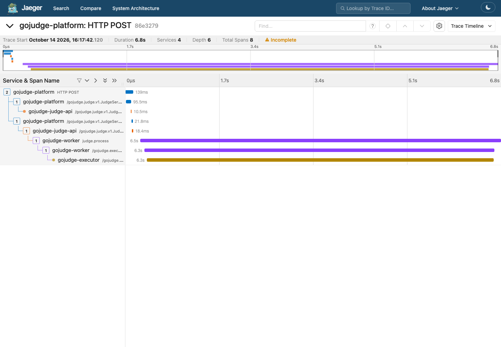
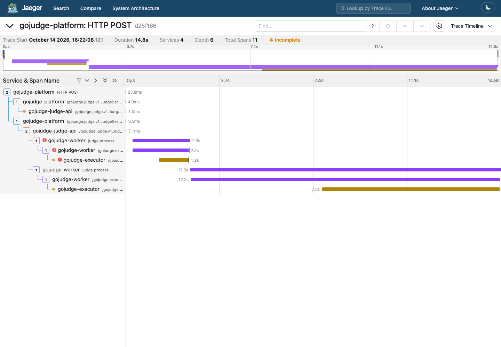

# 3. gRPC 调用治理与跨服务追踪

## 3.1 为什么用 gRPC，为什么不再加一套框架

gRPC 提供类型化协议、错误码、deadline、取消、health watch 和连接复用。项目已经有天然的远程执行边界，因此迁移的是实际运行链路，不是空的 HelloWorld 服务。公开浏览器 API 仍为 HTTP JSON；内部 Platform→Judge、Worker→Executor 使用 gRPC。旧 HTTP 部署保留，但新模式不会在 gRPC 失败后隐式回退 HTTP，否则会掩盖错误并可能重复执行。

协议在 [Judge v1](../../../api/proto/gojudge/judge/v1/judge.proto) 和 [Executor v1](../../../api/proto/gojudge/executor/v1/executor.proto)。不要编辑生成的 pb.go 来改接口。

## 3.2 版本演进与契约测试

增加可选字段保持既有编号、类型和语义；删除字段应 reserved 原编号/名称，不能重新赋予含义。不兼容变化引入新协议版本，再安排双版本迁移，不要求所有进程同一时刻发布。

冻结 [旧 Executor v1 fixture](../../../api/compat/executor/executor-v1.proto) 调用当前服务器的 `TestFrozenV1ClientWorksAgainstCurrentExecutor`，证明这个旧请求可被当前实现处理。它不是“所有老版本全兼容”的数学证明。protobuf wire 兼容也不自动保证业务语义兼容，例如改变时间限制解释可能仍然破坏客户端。

读 [兼容测试](../../../internal/executor/compatibility_test.go)。修改 proto 后运行 `make proto`、相关 RPC 测试和 `git diff`；需要本地 protoc 和指定版本的 Go generator，不能只提交 proto 不更新生成文件。

## 3.3 三种时间预算

| 层 | 默认值 | 包含什么 |
| --- | --- | --- |
| Platform→Judge | 5s | 创建、查询、产物等单次内部请求 |
| Worker→Executor | 120s | 健康连接等待、Admission 等待、编译和批量执行 |
| Worker task | 3min | Claim、拉对象、RPC、artifact 与最终落库 |

子 Context 使用 `WithTimeout(parent, duration)`，实际 deadline 为父 deadline 和本地预算中较早者，不能延长上游剩余时间。异步 Worker 继承 traceparent，而不是浏览器 HTTP 的取消 Context：浏览器断开后，已经成功受理的提交仍应执行。数据库受理前取消则可能回滚，结果未知时靠幂等查询解决。

Executor 收到 gRPC cancellation → Runner Context 取消 → Docker 操作清理沙箱。取消是传播机制，不是网络分区下的绝对实时保证，所以最终结果仍由数据库 fencing 防迟到写入。

读 [Executor Client](../../../internal/executor/grpc_client.go)、[Runner](../../../internal/judge/docker_runner.go)、[deadline 测试](../../../internal/executor/grpc_test.go)。

## 3.4 健康、负载、背压各做什么

Executor client 的手动 resolver 接收固定 endpoints；`round_robin` 在可用连接间选择，标准 `Health/Watch` 把 NOT_SERVING 实例排除。当前没有自动注册中心，因此加实例必须更新端点配置。不要把健康选择说成 Kubernetes discovery。

`WaitForReady(true)` 在暂时没有可用连接时等待，但等待仍受 deadline 限制，不是无限排队。Executor 另外限制执行槽位、最大等待者和等待时间；这是 Admission 背压，防止请求全部进入高成本 Docker 执行。

`/healthz` 表示活着；`/readyz` 表示可接业务或依赖可用；gRPC health 表示该实例的 RPC serving 状态。三者不等价。服务进入 drain 后不能因下一次健康探针重新变成 SERVING。

## 3.5 结果丢失为什么不能随便重试

请求没到服务端与“执行完成但响应丢失”都可能呈现网络错误。客户端无法仅凭这个错误确认用户程序是否执行，所以不配置执行级自动重试。`WithDisableRetry` 禁用配置型 retry policy；gRPC 仍可能在确认应用未处理等情况下做透明重试，不能把它概括为“任何网络发送都绝不会重发”。

本项目的边界是：不在一次已进入服务应用执行的 RPC 失败后偷偷回放用户代码；Worker 根据类型和总 attempt 预算决定是否新开 attempt；数据库 token 防止旧结果覆盖新结果。execution ID 是关联标识，不是 Executor 的去重缓存。

通用机制参考 [gRPC retry](https://grpc.io/docs/guides/retry/)；本仓库使用的 Go v1.76.0 `WithDisableRetry` 明确不影响透明重试，以所用语言/版本实现为准，不能用跨语言总览替代源码核对。Health/Watch 的配置依据见 [官方健康检查](https://grpc.io/docs/guides/health-checking/)。

真实 loopback 测试：[gRPC tests](../../../internal/executor/grpc_test.go) 中 `TestGRPCExecutionErrorNeverAutomaticallyReplays` 与 `TestGRPCLostResponseDoesNotReplaySuccessfulExecution`。后者让运行已完成的请求返回 Unavailable，断言 Runner 调用次数不被客户端自动增加；不是一次真实公网 TCP 丢包实验。

## 3.6 服务身份、用户身份与沙箱权限

RPC 先检查服务 token，之后才能执行应用 handler。Judge 还以 user ID + submission ID 检查资源归属；服务身份不能替代最终用户授权。token 使用常量时间比较；本地默认凭证只是演示值，不能用于公网。

TLS 配置有 cert/key/CA 三项时启用 TLS 1.3 与双向证书校验；配置不完整则启动失败，不静默回退明文。本地 Compose 不配置 TLS，内部 gRPC 端口不发布到宿主。已验证不完整配置拒绝，未完成真实跨主机证书轮换、吊销和服务身份授权矩阵。

Docker Socket 只在 Executor，Web/Worker 不持有。用户程序运行时降为 nobody、清空环境；可信计时包装器掌握 root 控制帧密钥。容器还受无网络、CPU/内存/PID/输出上限、只读文件系统和 no-new-privileges 约束。编译阶段仍是受限容器中的旧编译路径，不能泛称所有步骤均非 root，也不能把 Docker 说成 VM 级强多租户隔离。

## 3.7 Trace 不是什么

trace ID 关联一次逻辑流程，span ID 代表一次操作，parent span ID 表示因果关系。日志用于事件细节，metrics 用于聚合趋势，trace 用于某一次请求的跨进程耗时。高基数 submission / execution ID 适合 span 和日志，不适合作为 Prometheus 常驻 label。

```text
Platform HTTP POST
└── Judge CreateSubmission client
    └── Judge CreateSubmission server
        ├── Worker judge.process attempt-1  ← traceparent 经 Outbox/Stream 持久化
        │   └── Executor RunBatch client
        │       └── Executor RunBatch server（instance A）
        └── Worker judge.process attempt-2（发生任务级恢复时）
            └── Executor RunBatch client
                └── Executor RunBatch server（instance B）
```

HTTP span 名目前是通用 `HTTP METHOD`，不是逐路由 instrumentation。Judge / Executor RPC 有 client/server span；Worker 有 attempt span。Relay 传播 context，但没有自己单独的 publish span；Projector、SQL、对象 Get/Put 和 Docker 内部步骤也没有完整分段 span。不要在面试截图中推断不存在的覆盖。

资源字段有 `service.name` 和 `service.instance.id`；Executor 使用稳定 `EXECUTOR_INSTANCE_ID`，其他进程用 hostname。Worker span 有 `gojudge.execution_id`（`submission:attempt-N`）与 `gojudge.attempt`；错误 attempt 标为 Error。源码、隐藏输入输出、密码和 token 不写入 span attributes。

## 3.8 可选 Jaeger 演示

```bash
make judge-images
make microservices-tracing-up
make verify-microservices-tracing
# 打开 http://127.0.0.1:26686，或脚本打印的 /trace/<id>
```

[overlay](../../../deploy/compose/microservices-tracing.yml) 固定 Jaeger 2.22.0 及镜像 digest；UI 仅 loopback 26686，OTLP 4318 只在 Compose 内网。Jaeger 为内存存储，重启后 trace 丢失，默认采样配置仅用于教学；生产需要采样、持久化和保留策略。[Jaeger 官方入门](https://www.jaegertracing.io/docs/2.22/getting-started/)

验证脚本给提交附带采样 traceparent，等待 AC，然后从稳定 `/api/v3/traces/{id}` 查询实际 collector 数据；[验证器](../../../scripts/trace-report/main.go) 检查同一 trace、四个服务、连通父子树和 attempt 标识，不把存在字符串当作导出成功。[Jaeger 查询协议](https://www.jaegertracing.io/docs/2.22/architecture/apis/)

本次正常 trace 的实际截图：四服务、8 个 span，其中两次 Platform→Judge RPC分别是幂等查找和创建。



顶部 `Incomplete` 是因为脚本手工提供的外部父 span 没有发送到 collector；Platform 根 span 的外部 parent 不在数据中。验证器允许这一外部父节点，但要求四服务内部树连通。这不是承诺完整的浏览器到存储追踪；内存数据重启消失后，截图对应的 ID 也可能无法再查到。

故障演示必须保持 overlay：

```bash
CJ_MICRO_TRACING=1 bash scripts/verify-microservices-faults.sh
# 复制输出中的 trace ID，在 UI 查看两个 Worker attempt
```

SIGKILL 时 Executor 来不及 End/flush span，第一份 server span 可能缺失；Worker 的失败 span 和接管 attempt 仍可关联。这是可观测性的真实限制，不是判题结果丢失。不要求故障 trace 与正常 trace 一样完整。

强制 drain 的实测截图：第一次 attempt 及对应 RPC 标记错误，第二次在另一实例完成；collector 数据有 11 个 span、两个 acquired attempt、3 个 Error span。不是把一个程序错误自动重复跑到正确。



手动核对指定 trace：

```bash
trace_id=替换为脚本输出的32位十六进制ID
curl -fsS --connect-timeout 3 --max-time 10 \
  "http://127.0.0.1:26686/api/v3/traces/$trace_id?rawTraces=true" \
  | go run ./scripts/trace-report -trace-id "$trace_id" -min-attempts 2
```

`make microservices-tracing-down` 停止整个演示栈但保留业务数据卷；只想关闭追踪时，用不含 overlay 的配置重建应用进程，再单独停止 Jaeger。不能只停 Jaeger 后宣称应用已经取消导出配置。
